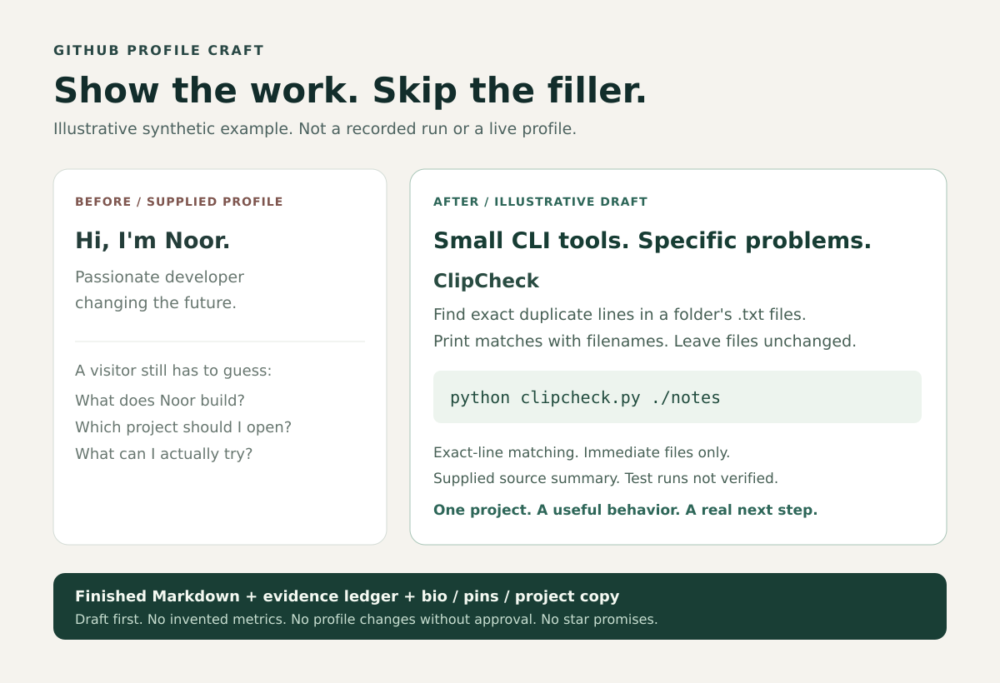

# GitHub Profile Tuner

## Make the work memorable. Then make the profile look like it.

A portable Agent Skill for turning a scattered GitHub presence into a clear,
evidence-backed showcase. Not another wall of badges. Not a star generator.

**Input:** a GitHub username or supplied project evidence.

**Output:** a finished profile README, a concise bio, a reasoned pin order,
project descriptions/topics, an evidence ledger, and a verification checklist.
Nothing changes on the actual profile until the owner approves.



Illustration, not a recorded model run. [Research and comparison](RESEARCH.md) ·
[Executed checks and limits](TEST-RESULTS.md) · [Trial and adoption plan](ADOPTION.md)

## Use it

Give the folder to an agent that supports the open `SKILL.md` format and say:

> Improve my GitHub profile. Lead with what makes my real work distinctive.
> Produce the finished files for review; do not change my live profile yet.

Or in Arabic:

> ظبط بروفايلي وخلي الشغل الحقيقي هو اللي يشد الناس. طلّعلي نسخة كاملة
> أراجعها، مش شوية نصايح وبادچات. متعدّلش البروفايل قبل ما أوافق.

### Install

Clone this repository, then place the **whole folder**, including the supporting Markdown files and optional lint script, in your agent's documented skills directory. Keep the folder
name `github-profile-tuner`. No package installation or API key is required by
the skill itself. Your agent needs its own GitHub reading capability.

This repository is private unless its owner changes that setting. Another
agent needs authorized repository access or a local copy. Do not paste access
tokens into prompts. Installation paths and support vary by agent version;
use that agent's current documentation, rather than assuming one universal path.

## What changed in v2.1

- Narrow requests stay narrow. A bio-only request does not force a full redesign.
- Local evidence snapshots work without invented live URLs.
- Examples and evaluations load only when needed.
- Optional Python lint checks completeness and common Markdown mistakes. It does
  not verify facts, links, rendering, approval or model quality.
- Public-source comparison, a reproducible fixture and an adoption plan make
  limitations visible rather than claiming universal superiority.

## Earlier v2 changes

| Before | Now |
|---|---|
| An audit and a presentation archetype | Finished README plus profile package |
| Generic style choices | One angle derived from the builder's actual work |
| Repository marketing repeated as fact | Observed, owner-stated, unverified evidence separated |
| Optional polish | First-screen, mobile, accessibility and link checks |
| No test fixtures | Six acceptance scenarios and a worked dry run |

[Read the worked example](EXAMPLE.md) to see the level of specificity.
[Read the evaluation cases](EVALS.md) to test an agent's output.

## What it will not do

- Invent users, clients, titles, test results, benchmarks, or testimonials.
- Promise stars, reach, search ranking, or hiring outcomes.
- Publish private information or change your profile without approval.
- Install tracking widgets, buy engagement, or send unsolicited launch posts.

The output is a draft package. A profile preview is not a deployed profile.
See TEST-RESULTS.md for executed checks. Passing lint or a small fixture is not
cross-agent certification or evidence of star growth.

## Files

- `SKILL.md`: the reusable workflow and output contract.
- `EXAMPLE.md`: evidence-backed example using public project descriptions and
  limited code inspection, with a clear verification boundary.
- `EVALS.md`: acceptance fixtures, scoring, and the test record.
- `check_package.py`: dependency-free offline output lint.
- `test_check_package.py`: regression tests for that script, not model tests.
- `TEST-FIXTURE.md` and `TEST-RESULTS.md`: fixed input and actual test boundaries.
- `RESEARCH.md`: sourced comparison and design decisions.
- `ADOPTION.md`: trial prompt, proposed demo recording and measurement plan.
- `DEMO.svg`: editable illustrative visual, not an execution recording.
- `LICENSE`: MIT.

## Optional checks

From the skill directory:

```sh
python test_check_package.py
python check_package.py /path/to/generated-output
```

The first command tests the lint script. The second checks the two output files.
Neither command runs a model, validates a biography or measures reach.

## Sources and credit

Built against the [Agent Skills specification](https://agentskills.io/specification)
and [skill-authoring guidance](https://agentskills.io/skill-creation/best-practices).
Profile mechanics follow [GitHub's own documentation](https://docs.github.com/en/account-and-profile/how-tos/setting-up-and-managing-your-github-profile/customizing-your-profile/managing-your-profile-readme).
The earlier version drew presentation inspiration from
[boffti/github-profile-readme](https://github.com/boffti/github-profile-readme).
No third-party benchmark claims are implied by this skill.

## License

MIT
